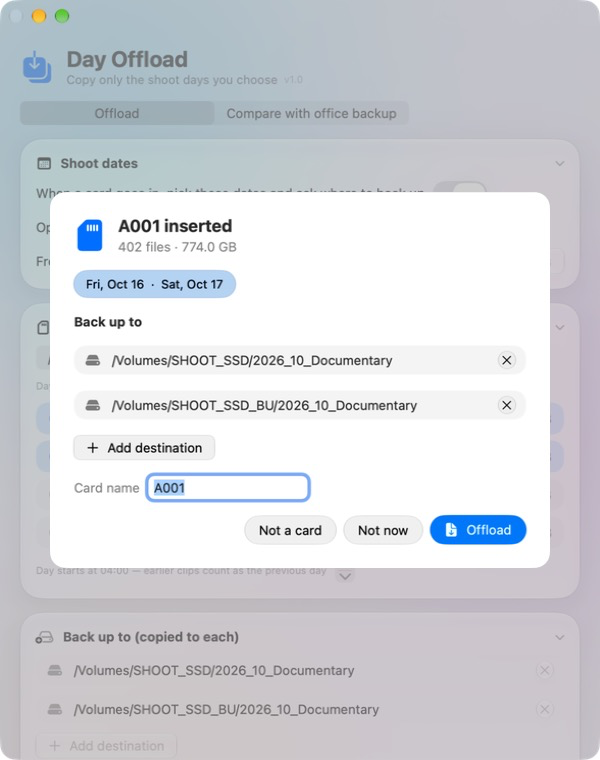
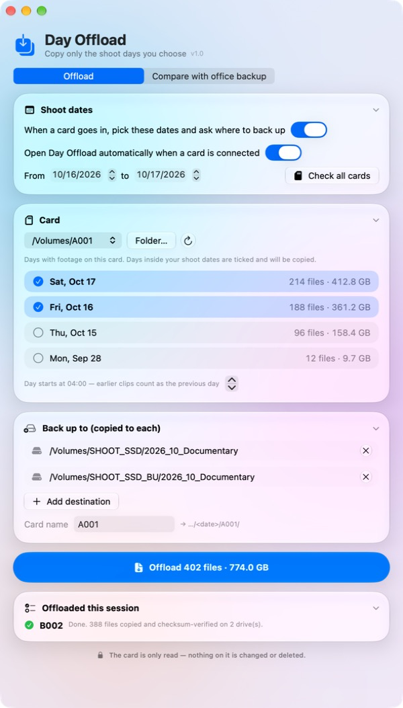
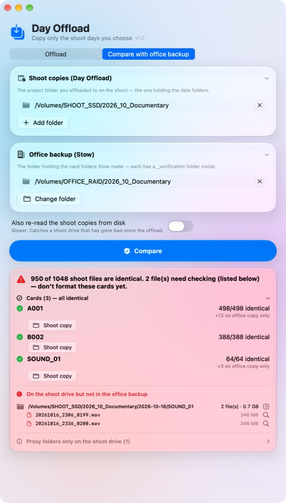

# Day Offload

A Mac app for multi-day shoots: **offload only the days you shot from a camera card — never the whole card, never touching the card.**

On a shoot you keep recording on the same cards day after day and only format them back at the office. Every offload tool you know copies the whole card each night; dragging today's clips out in Finder is risky. Day Offload copies just the shoot days you pick, checks every copy, and leaves the card exactly as it was.



## What it does

- **Copies by shoot day.** Each clip's day comes from the camera's own timestamps. A clip's proxy and sidecar files (`A001.braw`, `Proxy/A001.mp4`, `A001.sidecar` …) always travel with it, even if they were changed later. A "day starts at 04:00" setting keeps a night shoot that runs past midnight in the same day.
- **Set your shoot dates once.** When a card goes in, the app opens by itself, ticks the days inside your dates and asks where to back up. Several cards? They queue up and run one after another with the same dates.
- **Verified copies to every drive at once.** The card is read once and written to all destinations together. Then every copy is read back from the drive itself (cache bypassed) and checked against the card's checksum. Already-copied files are skipped, so offloading at lunch and again at wrap is safe.
- **The card is only read.** Nothing on it is changed, renamed or deleted.
- **Tidy folders.** `<drive>/<date>/<card>/…` with the card's own folder layout, plus a checksum record (`_offload_manifest.csv`, MD5 + xxHash3-128) in each.
- **Knows cards from drives.** Camera cards (Blackmagic, Sony, Canon, RED, DJI, audio recorders …) are recognised; backup drives and disk images are ignored, and a **Not a card** button silences any drive for good.



## Check the shoot copies against the office backup

Back at the office you back up each whole card with [Stow](https://www.lumirastudio.com). **Compare with office backup** then checks every file in your shoot folder — however it was copied — against the office copy:

- Day Offload copies are checked instantly: both apps record the same xxHash3-128 checksum, so nothing has to be read again.
- Files copied with Finder, or office folders made without Stow, are read and compared.
- You see, card by card, what's identical, what's different, and **exactly which files are on the shoot drive but missing from the office backup** — with Show in Finder buttons. Proxies made on the computer are listed separately.
- Checksums are remembered, so running it again takes seconds.



## Install

1. Download **DayOffload.zip** from the [latest release](https://github.com/kurikurikun/day-offload/releases/latest), unzip, and drag **Day Offload.app** into Applications.
2. Open it. The first time it reads a card, macOS asks for permission to access removable volumes — click **Allow**.

macOS 14 Sonoma or later, Apple Silicon or Intel. Liquid Glass look on macOS 26 and later.

## Build from source

Xcode or Command Line Tools — no Xcode project needed:

```bash
git clone https://github.com/kurikurikun/day-offload.git
cd day-offload
./build.sh        # builds and installs a dev copy in /Applications
./Tests/run.sh    # checks the built-in xxHash3-128 against reference vectors
```

`./make-app.sh` makes a signed, notarized, universal release zip (needs a Developer ID certificate).

## License

MIT — see [LICENSE](LICENSE). Made in Japan by [move-ment](https://move-ment.co).
